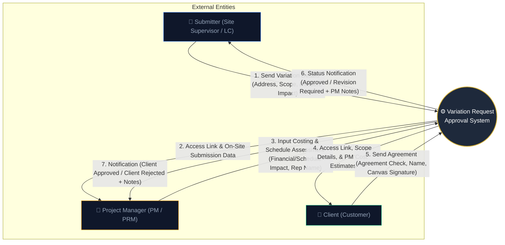

# DFD Level 0: Context Diagram

Below is the Data Flow Diagram (DFD) Level 0 (often referred to as the Context Diagram) for the **Variation Request Approval System**. This diagram shows the flow of incoming and outgoing data between the main system and external entities (Submitter, PM, and Client).

---

## Data Flow Descriptions

### 1. Submitter Interactions with the System
* **Data Flowing into the System**: The submitter fills out the request form from the field (Project Address, Date, Name, Scope Description, Reason for Change, Project Impact, and Client Email).
* **Data Flowing out of the System**: The system sends the final status notification. If approved, the submitter receives an *Approved* confirmation. If rejected by the PM, the submitter receives a revision link along with feedback/notes from the PM.

### 2. Project Manager (PM) Interactions with the System
* **Data Flowing out of the System**: The system sends an automated notification email containing a unique access link `/pm/[id]` and read-only details of the on-site submission data (Step 1).
* **Data Flowing into the System**: The PM inputs financial assessment data (cost impact type/amount), schedule assessment data (time impact type/days), company representative name (signature name), and internal remarks/rejection details.

### 3. Client Interactions with the System
* **Data Flowing out of the System**: The system sends an automated notification email containing a unique access link `/client/[id]` with read-only details of the scope change (Step 1) and PM costing/schedule details (Step 2).
* **Data Flowing into the System**: The client checks the agreement box, enters their sign-off name, date, and signs on the digital signature canvas board.
