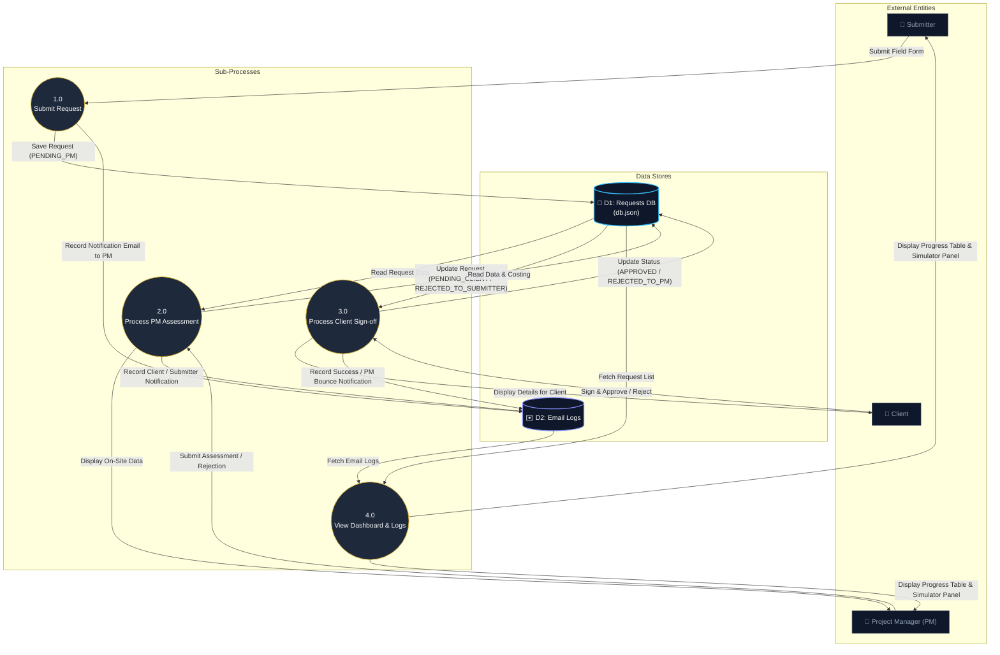

# DFD Level 1: Process Decomposition

Below is the Data Flow Diagram (DFD) Level 1 for the **Variation Request Approval System**. This diagram breaks down the main system into 4 key sub-processes and shows their interactions with the data stores (**Data Stores**).

---

## Process & Data Flow Descriptions (Level 1)

### **1.0 Submit Request (Initiation Process)**
* **Data Flow**: The Submitter sends field form data (Project Address, Scope, Reason, Impact).
* **Storage**: The system writes a new request record to data store **D1 (Requests DB)** with an initial status of `PENDING_PM`.
* **Notification**: The system records a new notification log in data store **D2 (Email Logs)** for the PM.

### **2.0 Process PM Assessment (Assessment Process)**
* **Data Flow**: The PM opens the form. The system reads request data from **D1** and displays it as read-only.
* **Updates**: The PM inputs their assessment (financial and schedule impact) or submits a rejection. This updates **D1** (changing status to `PENDING_CLIENT` if assessed, or `REJECTED_TO_SUBMITTER` if sent back for revision).
* **Notification**: The system records notification emails in **D2** (sent to the Client for sign-off or back to the Submitter for revision).

### **3.0 Process Client Sign-off (Client Review Process)**
* **Data Flow**: The Client opens the sign-off link. The system reads the request history (Step 1 and Step 2 details) from **D1** and displays it to the Client.
* **Updates**: The Client agrees (checking the agreement box, entering their name, and signing on the digital canvas) or rejects. The status in **D1** is updated to `APPROVED` (finalized) or `REJECTED_TO_PM` (bounced back to the PM for price adjustment).
* **Notification**: The system records notifications in **D2** to be sent to all relevant stakeholders.

### **4.0 View Dashboard & Logs (Monitoring Process)**
* **Data Flow**: The system continuously reads the request data from **D1** to render the dashboard table for the Submitter and PM.
* **Simulator Logs**: The system reads email logs from **D2** to render them inside the prototype simulator panel at the top of the application.
